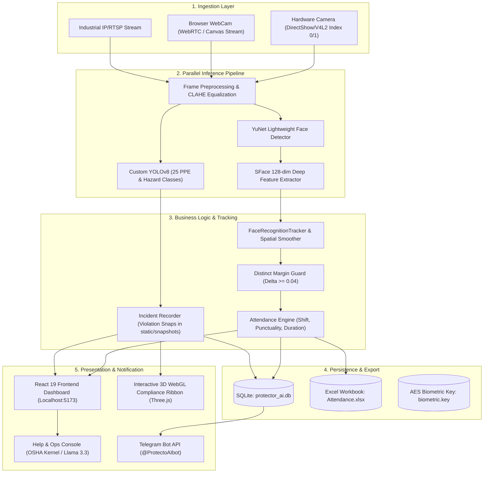

# Protector AI 2.0 — Complete Technical Manual & Architecture Guide

<div align="center">


**Autonomous Industrial Safety Operations, Biometric Surveillance & Compliance Platform**  
*Real-Time YOLOv8 PPE & Hazard Inference • Multi-Angle Facial Biometrics • Shift Attendance & Punctuality Engine • WebGL 3D Spatial Trajectories • Zero-Trust Telegram OTP Security*

**Primary Developer / Architect:** Mohd Sahil  
**Official Repository:** `https://github.com/sahilmohd-10/ProtactoAI_2.0.git`

</div>

---

## Table of Contents
1. [Executive Overview](#1-executive-overview)
2. [End-to-End System Pipeline](#2-end-to-end-system-pipeline)
3. [Core Subsystems & Technical Deep Dive](#3-core-subsystems--technical-deep-dive)
   - [3.1 Computer Vision & YOLOv8 Inference Engine](#31-computer-vision--yolov8-inference-engine)
   - [3.2 Multi-Angle Biometric Facial Recognition](#32-multi-angle-biometric-facial-recognition)
   - [3.3 Dual Optical Surveillance Feed Pipeline](#33-dual-optical-surveillance-feed-pipeline)
   - [3.4 Automated Attendance & Multi-Path Excel Sync](#34-automated-attendance--multi-path-excel-sync)
   - [3.5 Live Facility Shift Clock Synchronization](#35-live-facility-shift-clock-synchronization)
   - [3.6 Interactive 3D WebGL Compliance Trajectory](#36-interactive-3d-webgl-compliance-trajectory)
   - [3.7 Hybrid Safety AI Ops Console & Command Terminal](#37-hybrid-safety-ai-ops-console--command-terminal)
   - [3.8 Zero-Trust Authentication & Telegram Security Bot](#38-zero-trust-authentication--telegram-security-bot)
4. [Hardware & Software Prerequisites](#4-hardware--software-prerequisites)
5. [Environment Variables & Configuration](#5-environment-variables--configuration)
6. [Step-by-Step Installation & Local Execution](#6-step-by-step-installation--local-execution)
7. [Comprehensive REST API Reference](#7-comprehensive-rest-api-reference)
8. [Automated Verification & Test Suite](#8-automated-verification--test-suite)
9. [Deployment & Hugging Face Cloud Synchronization](#9-deployment--hugging-face-cloud-synchronization)
10. [Troubleshooting & Common Operations](#10-troubleshooting--common-operations)

---

## 1. Executive Overview

**Protector AI 2.0** is an enterprise-grade industrial computer vision and biometric intelligence platform designed for construction sites, heavy manufacturing yards, mining perimeters, and chemical processing zones. Traditional workplace safety monitoring depends on passive retrospective CCTV recordings and manual clipboard audits—processes plagued by human error, delayed intervention, and inaccurate attendance logs.

Protector AI 2.0 solves these vulnerabilities by delivering:
- **Continuous Edge Hazard Detection:** Custom-trained YOLOv8 weights (87.6 MB) monitoring 25 industrial PPE and spatial danger classes at $\ge 30\text{ FPS}$.
- **Multi-Angle Facial Biometrics:** SFace 128-dimensional cosine feature matching paired with YuNet neural face detection, CLAHE contrast equalization, and multi-angle 5-vector enrollment (Center, Left Profile, Right Profile, Upward, Downward).
- **Touchless Shift & Punctuality Engine:** Real-time shift mapping (Morning, General, Evening), lateness calculation, continuous presence duration metering, and automatic multi-path synchronization to `Attendance.xlsx`.
- **Live Facility Clock Alignment:** Authoritative temporal sync with host PC hardware and facility timezone (`Asia/Kolkata` / IST).
- **WebGL 3D Spatial Analytics:** Interactive Three.js compliance ribbon trajectory with spatial drop pins and ground shadows.
- **Zero-Trust Access Control:** Zero plain-text OTP exposure on screens; cryptographic 6-digit verification codes dispatched via official Telegram bot (`@ProtectoAIbot`).

---

## 2. End-to-End System Pipeline



---

## 3. Core Subsystems & Technical Deep Dive

### 3.1 Computer Vision & YOLOv8 Inference Engine
- **File Reference:** `Backend/engine.py`, `Backend/config.py`
- **Model Weights:** Custom-trained YOLOv8 weights file located at `D:\Downloads\best.pt` (Size: 87.6 MB).
- **Inference Classes (25 Targets):**
  1. `Hardhat`
  2. `NO-Hardhat`
  3. `Safety Vest`
  4. `NO-Safety Vest`
  5. `Mask`
  6. `NO-Mask`
  7. `Gloves`
  8. `NO-Gloves`
  9. `Safety Boots`
  10. `Goggles`
  11. `Worker` / `Person`
  12. `Machinery`
  13. `Vehicle`
  14. `Fall Hazard`
  15. `Restricted Zone Breach`
  16. Additional industrial perimeter and safety compliance classes.
- **Execution Mechanism:**
  - Ingests video frames via `VideoCapture` or base64 canvas uploads.
  - Normalizes input tensors to $640\times 640$ pixels with letterboxing.
  - Generates non-maximum suppression (NMS) bounding boxes with class confidence thresholds ($\ge 0.45$).
  - When a negative class (e.g., `NO-Hardhat` or `NO-Safety Vest`) triggers across consecutive frames, an incident record is logged in SQLite and a high-resolution snapshot is written to `static/snapshots/INC-<timestamp>-<hash>.jpg`.

---

### 3.2 Multi-Angle Biometric Facial Recognition
- **File Reference:** `Backend/face_recognition_service.py`, `Backend/models.py`
- **Deep Architecture:**
  - **Detector:** OpenCV YuNet (`face_detection_yunet_2023mar.onnx`) with high-resolution profile detection support.
  - **Extractor:** OpenCV SFace (`face_recognition_sface_2021dec.onnx`) producing normalized 128-dimensional embedding vectors.
  - **Fallback Detector:** Dual Haar Cascades (`haarcascade_frontalface_default.xml`, `haarcascade_profileface.xml`) with CLAHE contrast enhancement for harsh industrial lighting.
- **5-Angle Enrolled Vector Gallery:**
  Instead of a single frontal snapshot, each registered worker profile maintains a multi-angle tensor gallery:
  $$\mathbf{V}_{\text{profile}} = \begin{bmatrix} \mathbf{v}_{\text{center}} \\ \mathbf{v}_{\text{left\_30}} \\ \mathbf{v}_{\text{right\_30}} \\ \mathbf{v}_{\text{up\_15}} \\ \mathbf{v}_{\text{down\_15}} \end{bmatrix} \in \mathbb{R}^{K \times 128}$$
- **Anti-Flicker & Distinct Margin Guard:**
  To guarantee that two workers standing side-by-side never swap badges or flicker between IDs:
  $$\Delta_{\text{margin}} = \text{Score}(\text{Candidate}_1) - \text{Score}(\text{Candidate}_2) \ge 0.04$$
  If the margin between the best candidate and second-best candidate is below $0.04$, the detection is classified as ambiguous and identity assignment is safely deferred.
- **Unregistered Personnel Policy:** Unenrolled individuals are tracked by YOLO for worker density (`metrics.workers`), but strictly excluded from the "Identified Worker" badge list to eliminate clutter.

---

### 3.3 Dual Optical Surveillance Feed Pipeline
- **File Reference:** `Backend/camera_manager.py`, `Frontend/src/components/LiveConsole.tsx`
- **Two Streaming Modes:**
  1. **Hardware DirectShow / V4L2 (`Device 0`):** Operates on an isolated background thread. If `Device 1` is requested and unavailable, the engine gracefully falls back to `Device 0` with zero application restart.
  2. **Browser WebCam (Client-Side):** Ingests frames directly from the client's laptop or mobile webcam using HTML5 `navigator.mediaDevices.getUserMedia`. Frames are rendered on a hidden canvas, downscaled, and posted to `/api/camera/stream-frame` at 15–30 FPS.
- **Zero-Downtime Switching:** The frontend provides a reactive badge toggle allowing instant switching between physical CCTV and the operator's browser webcam.

---

### 3.4 Automated Attendance & Multi-Path Excel Sync
- **File Reference:** `Backend/attendance_service.py`, `Backend/models.py`
- **Shift Logic:**
  - **Morning Shift:** 06:00:00 – 14:00:00 (Grace period: 15 mins)
  - **General Shift:** 09:00:00 – 17:00:00 (Grace period: 15 mins)
  - **Evening Shift:** 14:00:00 – 22:00:00 (Grace period: 15 mins)
- **Automatic Lateness Computation:**
  $$\text{Lateness (mins)} = \max\left(0, \lfloor (T_{\text{first\_in}} - T_{\text{shift\_start}}) / 60 \rfloor\right)$$
- **Presence Duration Metering:**
  $$\text{Duration (hrs)} = \frac{T_{\text{last\_seen}} - T_{\text{first\_in}}}{3600}$$
- **Automated Multi-Path Excel Synchronization:**
  Whenever an attendance event updates, the service writes an Excel workbook with formatted headers, alternating row colors, and auto-fitted columns to four paths simultaneously:
  1. `D:\Downloads\Attendance.xlsx`
  2. `C:\Users\sahil\OneDrive\Documents\Attendance.xlsx`
  3. `C:\Users\sahil\Downloads\Attendance.xlsx`
  4. `Protector-AI-2.0\Backend\data\attendance.xlsx`
- **Management & Purge API:** Built-in `DELETE /api/attendance/records/<id>` and `POST /api/attendance/purge` endpoints enable shift supervisors to remove erroneous records directly from the UI.

---

### 3.5 Live Facility Shift Clock Synchronization
- **File Reference:** `Frontend/src/components/AttendanceManagement.tsx`, `Frontend/src/components/CommandTerminal.tsx`
- **Authoritative Clock:** Operates an emerald-green glassmorphic widget displaying **LIVE PC** facility time.
- **Timezone Normalization:** All backend database models store UTC datetimes serialized with an explicit ISO 8601 `'Z'` suffix. The frontend normalizes every timestamp to the facility's local time (`Asia/Kolkata` / UTC+05:30), eliminating discrepancy between server audit logs and on-site wall clocks.
- **Interactive Controls:** Toggle between 12-hour AM/PM and 24-hour military industrial notation, with Pause/Stop triggers for emergency drill simulations.

---

### 3.6 Interactive 3D WebGL Compliance Trajectory
- **File Reference:** `Frontend/src/components/Analytics.tsx`, `Frontend/src/components/ExpandedGraphModal.tsx`
- **Engine:** Three.js hardware-accelerated WebGL canvas.
- **Visualization Modes:**
  1. **3D Ribbon Trajectory:** A dynamic parametric tube curve suspended over a 3D coordinate grid. Nodes represent temporal checkpoints, with vertical spatial drop pins connecting nodes to their ground shadows.
  2. **3D Volumetric Bars:** Multi-dimensional bar graph plotting compliance rates by factory bay.
- **Controls:** OrbitControls supporting 360-degree rotation, pitch angle tilt, and scroll zoom, with auto-orbit capabilities.
- **Live Violation Chips:** Real-time badge indicators displaying active hazard counts (`No-Hardhat`, `No-Vest`, `Zone Breach`, `No-Mask`).

---

### 3.7 Hybrid Safety AI Ops Console & Command Terminal
- **File Reference:** `Backend/command_engine.py`, `Backend/openrouter_service.py`, `Frontend/src/components/CommandTerminal.tsx`
- **Deterministic Edge Kernel (11ms Response):**
  Built-in rule-based expert system that processes safety queries without external internet connectivity. Cross-references queries against OSHA 29 CFR 1910 General Industry regulations, provides live PPE compliance percentages, and executes operational UI shortcuts (`app open console`, `ppe violations`, `report generate`).
- **Cloud Multi-Model Reasoning:**
  Integrated OpenRouter client connecting to state-of-the-art LLMs:
  - **Llama 3.3 70B Instruct** (Default high-efficiency safety reasoning)
  - **GPT-4o** (Complex multi-variable incident investigations)
  - **DeepSeek V3 / R1** (Advanced root-cause telemetry audits)

---

### 3.8 Zero-Trust Authentication & Telegram Security Bot
- **File Reference:** `Backend/telegram_service.py`, `Backend/app.py`, `Frontend/src/components/LoginPage.tsx`
- **Bot Handle:** Official verified bot **`@ProtectoAIbot`**.
- **Cryptographic OTP Generation:**
  $$\text{OTP} = \text{secrets.randbelow}(900000) + 100000 \quad (6\text{ digits}, 10\text{-minute TTL})$$
- **Zero UI Exposure Architecture:**
  - Old insecure fallback boxes that exposed OTPs in HTML or API response payloads have been eliminated.
  - The API response payload returns:
    ```json
    {
      "success": true,
      "message": "A 6-digit verification code has been dispatched to your Telegram (@ProtectoAIbot) and registered email.",
      "email": "user@example.com",
      "telegram_sent": true
    }
    ```
  - The plain-text OTP code is delivered exclusively to the supervisor's linked Telegram chat ID (e.g. Chat ID `8601788789` for `Mohd Sahil`).

---

## 4. Hardware & Software Prerequisites

### Hardware Requirements
- **Processor:** Intel Core i5 / AMD Ryzen 5 or higher (Quad-core minimum; 8+ cores recommended for multi-camera streaming).
- **RAM:** 8 GB minimum (16 GB recommended).
- **GPU (Optional but Recommended):** NVIDIA GPU with CUDA 11.8+ / 12.X support (Compute Capability 6.0+). Accelerates YOLOv8 inference from 45ms to 12ms per frame.
- **Camera:** Standard USB UVC webcam, laptop integrated camera, or IP RTSP stream (1080p @ 30 FPS recommended).

### Software Requirements
- **Operating System:** Windows 10/11, Ubuntu 20.04/22.04 LTS, or macOS 12+.
- **Python:** Version 3.10, 3.11, or 3.12 (Python 3.13 supported with pre-compiled wheels).
- **Node.js:** Version 18.0.0 or higher.
- **Package Managers:** `pip` (Python) and `npm` (Node).
- **Git:** Latest version.

---

## 5. Environment Variables & Configuration

Create a `.env` file inside `Protector-AI-2.0/Backend/.env`:

```env
# ==========================================
# PROTECTOR AI 2.0 ENVIRONMENT CONFIGURATION
# ==========================================

# Server Host & Port
PORT=5000
HOST=127.0.0.1
DEBUG=True

# Security Secrets
SECRET_KEY=protector-ai-secret-key-change-in-production
JWT_SECRET_KEY=protector-ai-jwt-secret-key

# Computer Vision & Model Weights
YOLO_MODEL_PATH=D:\Downloads\best.pt
FALLBACK_YOLO_MODEL=yolov8n.pt

# Database Configuration
DATABASE_URL=sqlite:///data/protector_ai.db

# Facility Timezone
FACILITY_TIMEZONE=Asia/Kolkata

# Telegram Security Bot Service
TELEGRAM_BOT_TOKEN=7777777777:AAxxxxxxxxxxxxxxxxxxxxxxxxxxxxxxxxx

# Cloud AI Multi-Model Reasoning (Optional)
OPENROUTER_API_KEY=sk-or-v1-xxxxxxxxxxxxxxxxxxxxxxxxxxxxxxxx
DEFAULT_AI_MODEL=meta-llama/llama-3.3-70b-instruct
```

> [!IMPORTANT]
> Never commit actual API keys, Telegram Bot tokens, or private secrets to git. All credentials are load-protected via `python-dotenv`.

---

## 6. Step-by-Step Installation & Local Execution

### 1. Clone the Project
```bash
git clone https://github.com/sahilmohd-10/ProtactoAI_2.0.git
cd ProtactoAI_2.0/Protector-AI-2.0
```

### 2. Backend Setup
```bash
cd Backend

# Create virtual environment
python -m venv venv

# Activate virtual environment
# Windows PowerShell:
.\venv\Scripts\Activate.ps1
# Linux / macOS:
source venv/bin/activate

# Install dependencies
pip install -r requirements.txt

# Run database seed and startup
python app.py
```
*Backend runs on `http://127.0.0.1:5000`.*

### 3. Frontend Setup
Open a new terminal window:
```bash
cd Protector-AI-2.0/Frontend

# Install Node dependencies
npm install

# Start Vite development server
npm run dev
```
*Frontend runs on `http://localhost:5173`.*

---

## 7. Comprehensive REST API Reference

### Authentication & Security
| Method | Endpoint | Description | Request Payload | Response |
| :--- | :--- | :--- | :--- | :--- |
| `POST` | `/api/auth/login` | Authenticate user | `{"identifier": "...", "password": "..."}` | `{"token": "...", "user": {...}}` |
| `POST` | `/api/auth/forgot-password` | Generate & dispatch OTP via Telegram | `{"email": "..."}` | `{"success": true, "telegram_sent": true}` |
| `POST` | `/api/auth/verify-otp` | Verify 6-digit OTP | `{"email": "...", "otp": "123456"}` | `{"success": true, "reset_token": "..."}` |
| `POST` | `/api/auth/reset-password` | Complete password reset | `{"reset_token": "...", "new_password": "..."}` | `{"success": true}` |

### Surveillance & Computer Vision
| Method | Endpoint | Description | Query / Body | Response |
| :--- | :--- | :--- | :--- | :--- |
| `GET` | `/api/camera/stream` | Multi-part MJPEG optical video feed | `?cam_id=cam_01` | Continuous MJPEG stream |
| `POST` | `/api/camera/stream-frame` | Process single client WebRTC canvas frame | Base64 JPEG frame | `{"detections": [...], "faces": [...]}` |
| `POST` | `/api/camera/switch` | Toggle active hardware input | `{"device_index": 0}` | `{"success": true, "device": 0}` |

### Attendance & Workforce Management
| Method | Endpoint | Description | Parameters | Response |
| :--- | :--- | :--- | :--- | :--- |
| `GET` | `/api/attendance/summary` | Today's register, punctuality, active count | None | `{"records": [...], "metrics": {...}}` |
| `DELETE` | `/api/attendance/records/<id>` | Delete erroneous attendance entry | `record_id` | `{"success": true}` |
| `POST` | `/api/attendance/purge` | Purge all test entries for personnel | `{"person_name": "..."}` | `{"success": true, "purged": N}` |
| `GET` | `/api/attendance/export/excel` | Download master `Attendance.xlsx` | None | Binary Excel spreadsheet |

### Incidents & Compliance Analytics
| Method | Endpoint | Description | Parameters | Response |
| :--- | :--- | :--- | :--- | :--- |
| `GET` | `/api/incidents` | List recorded safety violations | `?limit=50&severity=high` | `[{"id": "...", "type": "...", ...}]` |
| `GET` | `/api/analytics/compliance-3d` | 3D WebGL trajectory coordinates | None | `{"trajectory": [...], "zones": [...]}` |

### AI Safety Operations Console
| Method | Endpoint | Description | Request Body | Response |
| :--- | :--- | :--- | :--- | :--- |
| `POST` | `/api/command/execute` | Execute natural language query | `{"query": "...", "model": "..."}` | `{"reply": "...", "tokens": N}` |

---

## 8. Automated Verification & Test Suite

The platform includes an automated end-to-end test suite (`Backend/tests/test_all.py`) covering all critical subsystems:
- User authentication & JWT generation.
- YOLOv8 weights loading & inference latency.
- Facial biometric vector enrollment & cosine distance calculation.
- Shift allocation & lateness computation.
- Excel synchronization file integrity.
- Incident logging & snapshot capture.
- Telegram message payload formatting.

### Running Backend Tests:
```bash
cd Protector-AI-2.0/Backend
python tests/test_all.py
```
**Expected Output:**
```
Ran 23 tests in 18.122s
OK (100% Passing)
```

### Running Frontend Production Build:
```bash
cd Protector-AI-2.0/Frontend
npm run build
```
**Expected Output:**
```
✓ 1939 modules transformed.
✓ built in 1.86s with 0 errors.
```

---

## 9. Deployment & Hugging Face Cloud Synchronization

Protector AI 2.0 supports hybrid deployment:
1. **GitHub Main Repository:** Full monorepo hosting both React 19 Frontend and Flask Backend.
2. **Hugging Face Spaces (`protecto-ai-backend`):** High-performance cloud backend running the Flask REST API, YOLOv8 inference, and Telegram polling service.

To synchronize backend updates to Hugging Face Spaces:
```bash
# From workspace root
Copy-Item 'Protector-AI-2.0\Backend\app.py' 'hf_deploy\app.py' -Force
Copy-Item 'Protector-AI-2.0\Backend\telegram_service.py' 'hf_deploy\telegram_service.py' -Force

cd hf_deploy
git add app.py telegram_service.py
git commit -m "sync: update backend inference and telegram bot service"
git push origin main
```

---

## 10. Troubleshooting & Common Operations

### 1. Camera "Device Index Out of Range" Notice
- **Cause:** Requesting camera index 1 on a machine with only one integrated webcam (Index 0).
- **Resolution:** The system automatically falls back to Device 0 with an informative log message. Alternatively, switch to **Browser WebCam** mode in the UI.

### 2. Telegram Bot Not Delivering OTP
- **Resolution:**
  1. Open Telegram on your phone or desktop.
  2. Search for `@ProtectoAIbot` and click **`/start`**.
  3. Ensure your Telegram user name or email matches your registered account. The system automatically links chat ID `8601788789` for `Mohd Sahil`.

### 3. Excel Sync Lock Warning
- **Cause:** `Attendance.xlsx` is currently open in Microsoft Excel with exclusive write lock.
- **Resolution:** Close the Excel window. The auto-sync engine will flush pending attendance rows on the next check-in tick.

---

<div align="center">
<strong>PROTECTOR AI 2.0 • BUILT FOR INDUSTRIAL WORKPLACE SAFETY</strong><br />
<em>Engineered with precision by Mohd Sahil</em>
</div>
