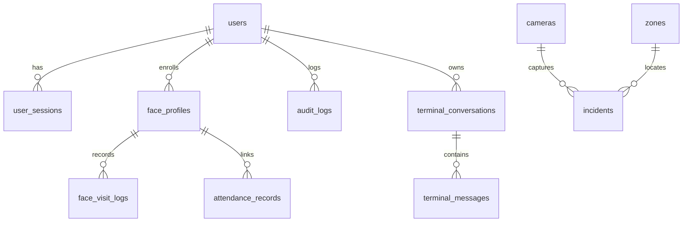

# Database Schema & Entity Audit: Protector AI 2.0
**Document Version**: 2.0.0  
**Date**: November 2026  
**Auditor**: Lead Database Architect  

---

## 1. Persistence Layer Architecture

Protector AI 2.0 utilizes **SQLAlchemy 2.1+ ORM** configured over an embedded **SQLite** database engine located at:
- Primary DB: `Backend/data/protector_ai.db` (auto-created on initialization)
- Mirror / Working DB: `Backend/protector_ai.db`

The engine uses scoped sessions with thread-safe connection pooling, automatic schema creation via `Base.metadata.create_all(bind=engine)`, and WAL (Write-Ahead Logging) journaling for concurrent read/write stability.

---

## 2. Entity Relationship Diagram (ERD)

---

## 3. Comprehensive Table Schema Breakdown

### 3.1 `users`
Stores system accounts for role-based access control (Admin vs. Operator).

| Column | Type | Constraints | Description |
| :--- | :--- | :--- | :--- |
| `id` | Integer | PK, Auto-increment | Unique user identifier |
| `username` | String(80) | Unique, Not Null, Index | Login handle |
| `first_name` | String(80) | Nullable | User first name |
| `last_name` | String(80) | Nullable | User last name |
| `name` | String(160) | Not Null | Display name |
| `email` | String(120) | Unique, Not Null, Index | Contact & auth email |
| `phone_number` | String(30) | Nullable | Contact number |
| `password_hash` | String(255) | Not Null | Argon2id password hash |
| `role` | String(20) | Default: "Operator" | "Administrator" or "Operator" |
| `status` | String(20) | Default: "Active" | "Active" or "Inactive" |
| `last_active` | DateTime | UTC Default | Last API interaction timestamp |
| `created_at` | DateTime | UTC Default | Account creation date |

### 3.2 `user_sessions`
Active authentication bearer tokens.

| Column | Type | Constraints | Description |
| :--- | :--- | :--- | :--- |
| `id` | Integer | PK, Auto-increment | Session primary key |
| `token` | String(128) | Unique, Not Null, Index | Bearer authentication token |
| `user_id` | Integer | Not Null | Foreign link to `users.id` |
| `created_at` | DateTime | UTC Default | Token generation timestamp |
| `expires_at` | DateTime | Not Null | Token expiration timestamp (24h) |
| `ip_address` | String(50) | Default: "127.0.0.1" | Client remote IP |
| `user_agent` | String(255) | Default: "" | Client browser string |

### 3.3 `face_profiles`
Enrolled personnel for biometric recognition.

| Column | Type | Constraints | Description |
| :--- | :--- | :--- | :--- |
| `id` | Integer | PK, Auto-increment | Biometric employee ID |
| `name` | String(120) | Not Null | Enrolled full name |
| `consent_recorded`| Boolean | Not Null, Default: False | Explicit biometric consent flag |
| `consented_at` | DateTime | Not Null | Timestamp of consent verification |
| `enrolled_by_user_id`| Integer | Not Null | Enrolling administrator ID |
| `encrypted_templates`| Text | Not Null | Fernet AES-256 encrypted payload |
| `last_seen_at` | DateTime | Nullable | Last camera detection timestamp |
| `created_at` | DateTime | UTC Default | Enrollment timestamp |

### 3.4 `face_visit_logs`
Fine-grained biometric visit telemetry.

| Column | Type | Constraints | Description |
| :--- | :--- | :--- | :--- |
| `id` | Integer | PK, Auto-increment | Visit log identifier |
| `profile_id` | Integer | Not Null, Index | Link to `face_profiles.id` |
| `recognized_at` | DateTime | UTC Default, Index | Recognition timestamp |
| `match_distance`| Float | Not Null | Facial feature distance / similarity |
| `camera_source` | String(80) | Default: "People scanner" | Detection camera / sensor source |

### 3.5 `attendance_records`
Consolidated daily biometric attendance and shift register.

| Column | Type | Constraints | Description |
| :--- | :--- | :--- | :--- |
| `id` | Integer | PK, Auto-increment | Attendance record primary key |
| `date` | String(20) | Not Null, Index | Record date (`YYYY-MM-DD`) |
| `profile_id` | Integer | Nullable, Index | Link to `face_profiles.id` |
| `person_name` | String(120) | Not Null, Index | Verified worker name |
| `first_in` | DateTime | Not Null, UTC Default | Initial check-in timestamp |
| `last_out` | DateTime | Not Null, UTC Default | Most recent camera scan timestamp |
| `total_hours` | Float | Default: 0.0 | Calculated on-site duration |
| `status` | String(30) | Default: "Present" | "Present", "Full Day", "Half Day" |
| `check_in_count`| Integer | Default: 1 | Cumulative detections today |
| `camera_source` | String(100) | Default: "Optical Scanner" | Entry gate or camera ID |
| `verification_mode`| String(50) | Default: "Facial Biometrics" | "Facial Biometrics" or "Manual Override" |
| `notes` | Text | Default: "" | Administrative notes |
| `updated_at` | DateTime | UTC Default, OnUpdate | Last record modification timestamp |

### 3.6 `incidents`
Safety violations and OSHA non-compliance events.

| Column | Type | Constraints | Description |
| :--- | :--- | :--- | :--- |
| `id` | String(50) | PK | Unique incident code (e.g. `INC-1792...`) |
| `title` | String(200) | Not Null | Violation title (e.g. "Missing Hardhat") |
| `category` | String(50) | Not Null | PPE violation category |
| `severity` | String(20) | Default: "High" | "Critical", "High", "Medium", "Low" |
| `status` | String(20) | Default: "Open" | "Open", "Acknowledged", "Resolved" |
| `location` | String(100) | Not Null | Physical plant location |
| `camera_id` | String(50) | Default: "cam_01" | Source camera identifier |
| `worker_id` | String(50) | Default: "W-409" | Anonymous or assigned worker tag |
| `assigned_to` | String(100) | Default: "Unassigned" | Identified worker name (if $\ge 80\%$) |
| `timestamp` | DateTime | UTC Default | Event occurrence timestamp |
| `snapshot_url` | String(255) | Default: "" | Static image path |
| `bounding_boxes`| Text | Default: "[]" | JSON array of detected object boxes |
| `resolution_notes`| Text | Default: "" | Corrective action documentation |
| `resolved_at` | DateTime | Nullable | Resolution timestamp |

---

## 4. Data Integrity & Migration Plan
- **Indexes**: Critical queries (`date`, `person_name`, `profile_id`, `token`) have dedicated B-Tree indexes for fast scan times.
- **Foreign Keys**: Currently enforced at application level via SQLAlchemy scoped sessions.
- **Production Migration Recommendation**: For deployments exceeding 50 concurrent camera streams, execute Alembic migration script to export SQLite schemas directly into PostgreSQL 16+ without schema changes.
